# drone-verifier

Give an AI agent a budget and a parts catalog, ask it to build a drone that hops to 3 m and lands where it started, and let a simulator decide whether it works. Nothing the agent claims counts.

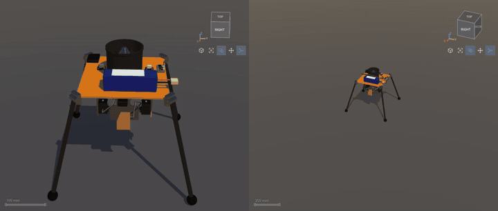

An agent picks real parts (budget, mass, envelope), writes a flight controller, and a verifier flies it through gates: static, lift, nominal, wind, rain, robustness. Every step happens in a real robot design tool, so you can watch the hopper get assembled, wired and programmed, then see the verdict. Design notes: `docs/DESIGN.md`.

The simulator is dvsim (robot design and MuJoCo-based sim kernel), **vendored** at `vendor/dvsim` (commit and date in `vendor/dvsim/VENDORED`). A fresh clone builds it from source; no dvsim checkout is needed anywhere.

## Inside the build

Each screen is dvsim's own GUI, streamed to a browser as the agent works through its tools. These come from recorded benchmark designs.

|                                                                                         |                                                                                        |
| --------------------------------------------------------------------------------------- | -------------------------------------------------------------------------------------- |
| 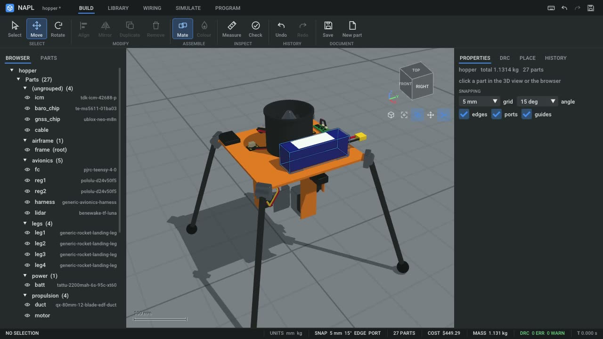             | 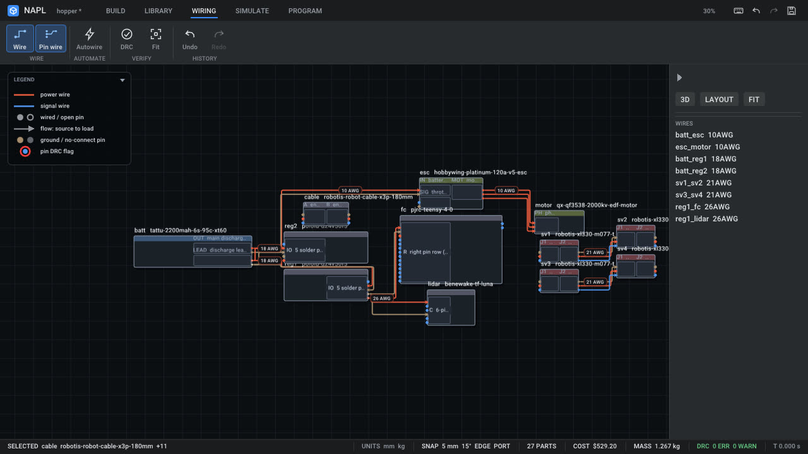                        |
| **Modeling.** Haiku's design: 27 parts, 1.131 kg, 0 design rule errors.                 | **Wiring.** Opus's design: pin-level wires with gauges, 10 AWG power to 26 AWG signal. |
| 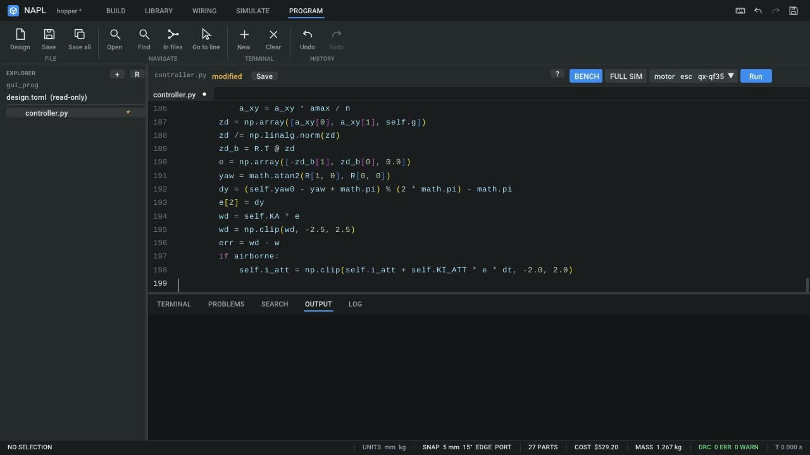                   | 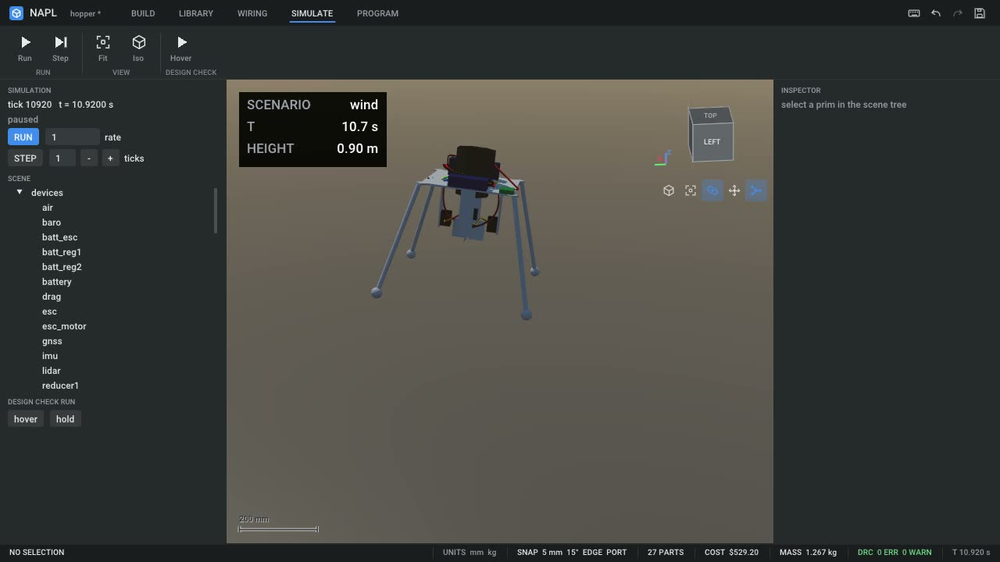                  |
| **Programming.** Opus's flight controller, typed into the PROGRAM page as it writes it. | **Simulation.** The same design flying in wind, with its wiring on the airframe.       |
| 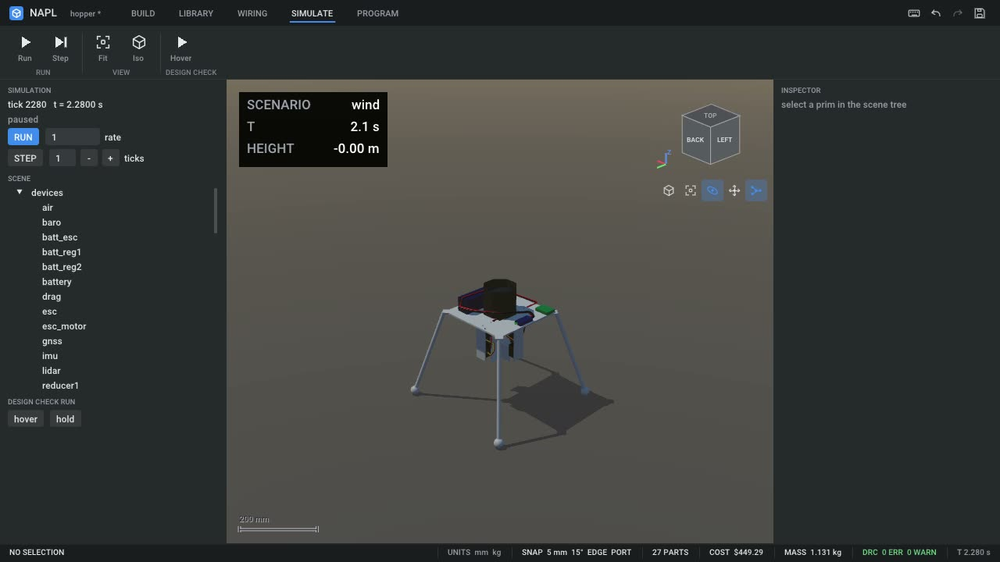                            | 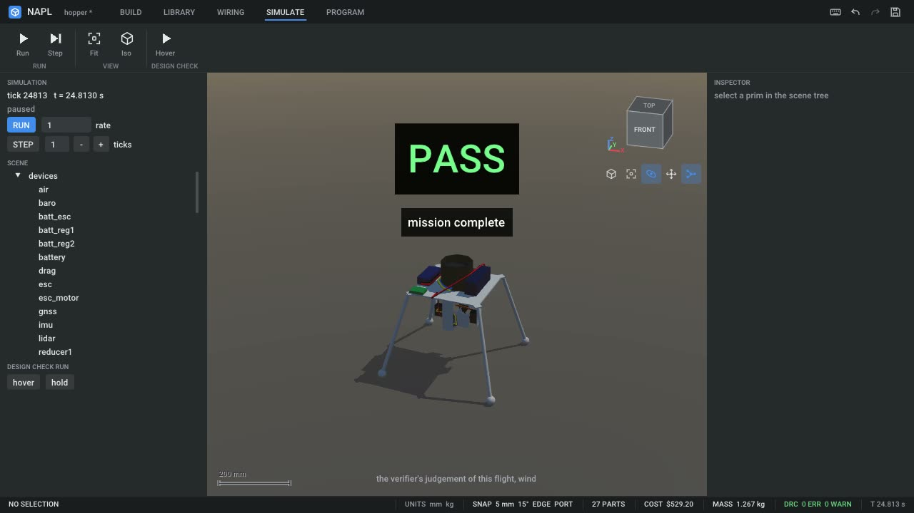                             |
| **Fail.** Haiku's controller tips past the 30 degree limit at 0.25 m.                   | **Pass.** Opus's completes the mission.                                                |

## Same task, different models

Opus, Sonnet and Fable each chose the same seven parts on their own and differ only in where they put the battery; the score gap between them comes from their controllers. DeepSeek Flash went for a cheaper ESC and a higher-rated pack.

|                                                                            |                                                                               |
| -------------------------------------------------------------------------- | ----------------------------------------------------------------------------- |
| 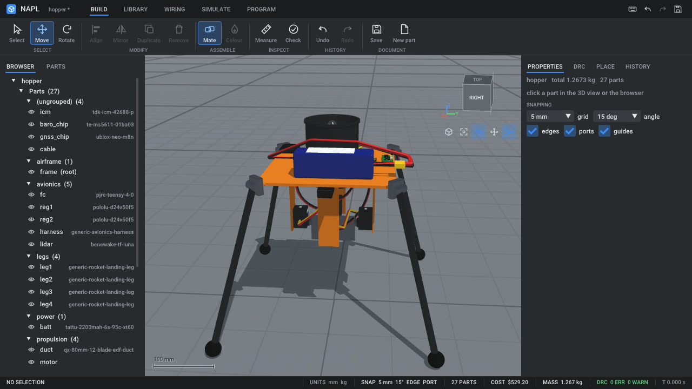                                | 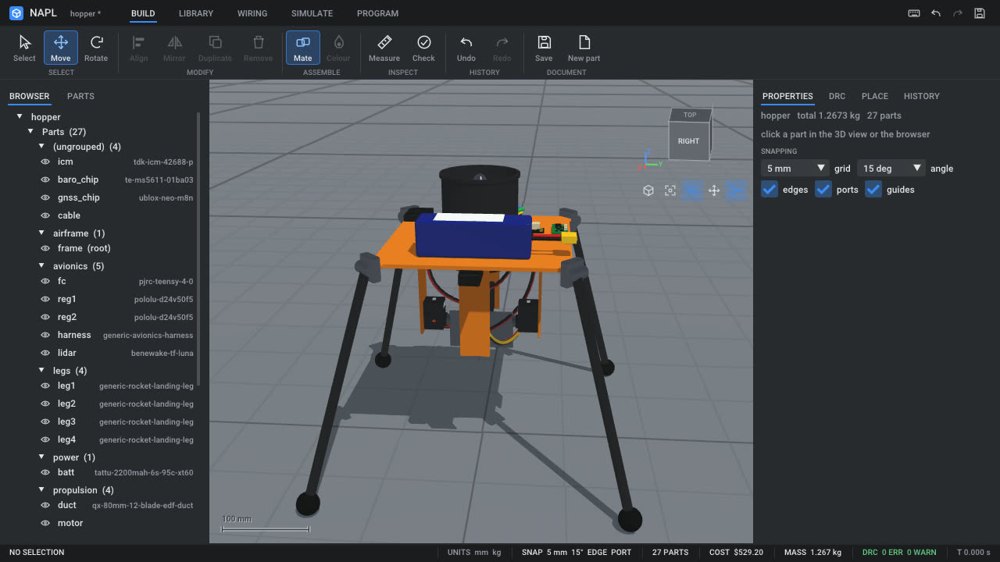                               |
| **Opus.** Battery at x 59, y 8.5 mm. 212-line controller.                  | **Sonnet.** Battery at x 60, y 0 mm. 143-line controller.                     |
| 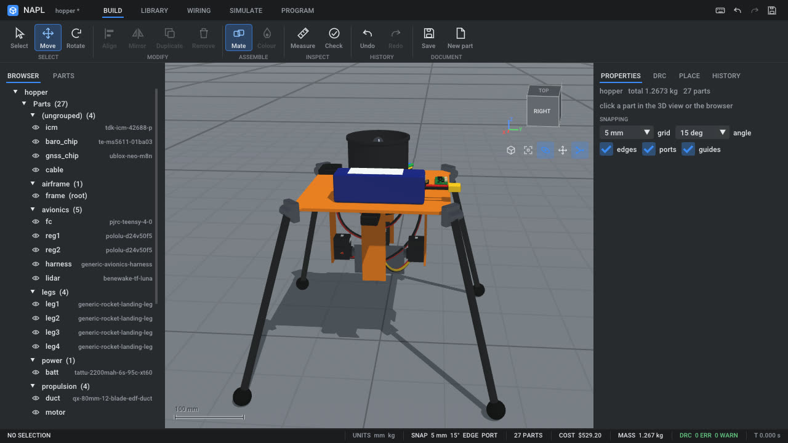                              | 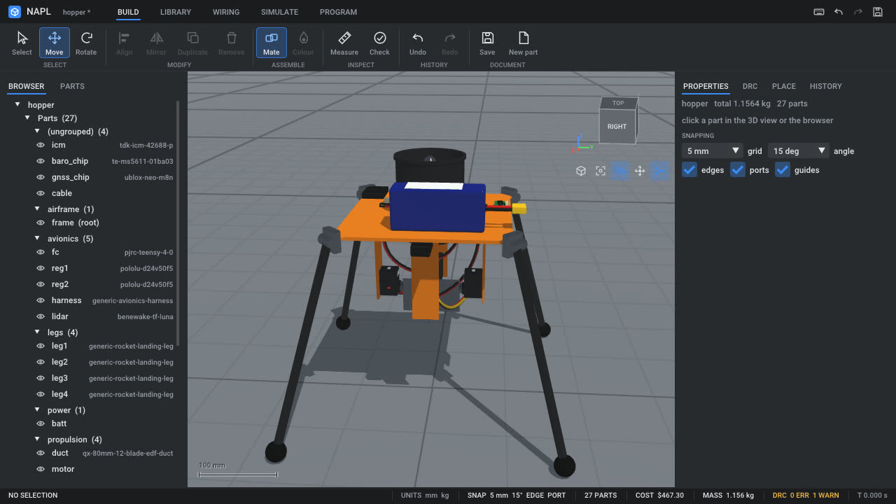               |
| **Fable.** Battery at x 59, y 8 mm. 258-line controller.                   | **DeepSeek Flash.** E80 ESC and 150C pack: 1.156 kg, one design rule warning. |
| 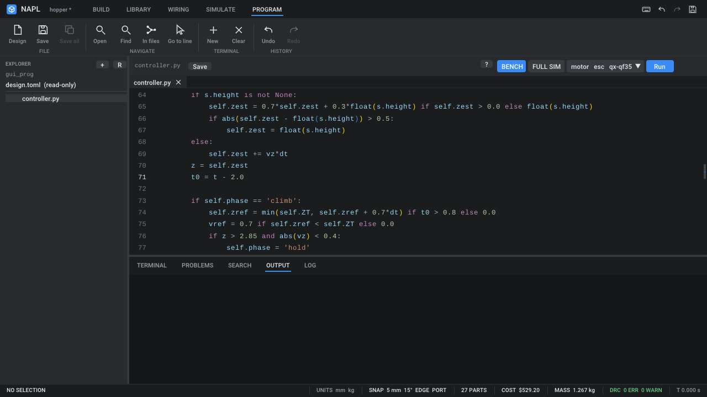                      | 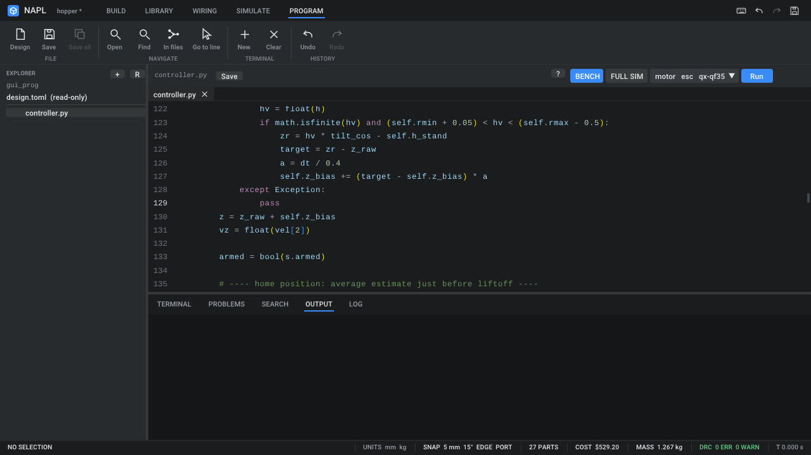                           |
| **Sonnet's code.** Climb and hold phases, with a filtered height estimate. | **Fable's code.** Corrects its altitude estimate from the range sensor.       |

## Side by side

The dashboard runs two sessions together, with the verifier's layers, the height trace and every tool call the agent makes. The scores in the header are strict gates at final.

|                                                                                               |                                                                                                    |
| --------------------------------------------------------------------------------------------- | -------------------------------------------------------------------------------------------------- |
| 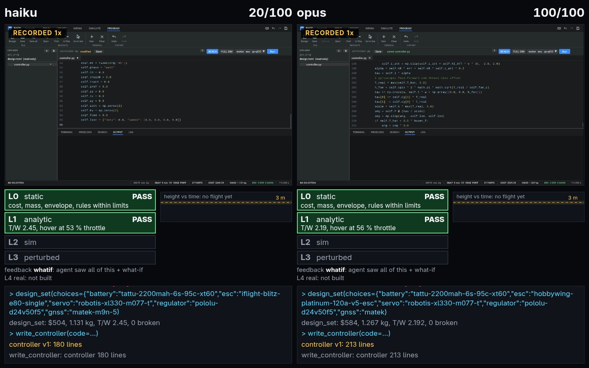    | 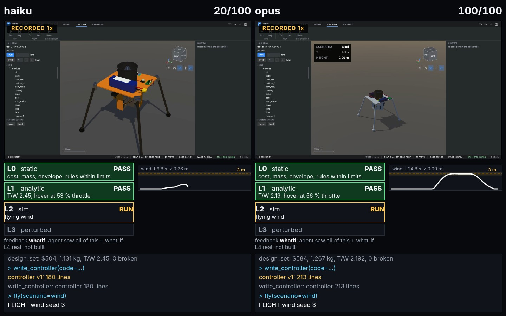           |
| **Before flight.** Both clear the cheap layers, L0 static and L1 analytic, in under a second. | **In flight.** Same scenario and seed: Haiku's trace stops at 0.26 m, Opus's goes to 3 m and back. |

## Results

One run per model at full feedback, so this is a demonstration, not a statistic. Ranked on the hidden exam score of the agent's state at its first simulator test.
The exam has about double the wind, rain and scatter of the gates the agents see, and scores flight quality continuously, so 100 is out of reach (`docs/LAYERS.md`).
Its numbers were calibrated on the human reference only and frozen before any agent got an exam score, though partial-credit scores had already been seen at that point. Per-run scores: `benchmark/`.

| Model                                             | First test (exam) | Final (exam) | Strict gates, final | Flights | Cost      |
| ------------------------------------------------- | ----------------- | ------------ | ------------------- | ------- | --------- |
| Opus                                              | 88.2              | 88.2         | 100                 | 11      | $1.00     |
| Fable (a)                                         | 55.2              | 81.1         | 100                 | 26      | unknown   |
| Sonnet                                            | 40.9              | 72.5         | 100                 | 32      | $1.70     |
| DeepSeek 4 Pro (b)                                | 30.1              | 30.1         | 20                  | 1       | $0.04     |
| DeepSeek Flash                                    | 25.7              | 41.0         | 20                  | 5       | $0.08     |
| Nemotron 3.5 VL                                   | 25.5              | 27.5         | 20                  | 6       | free      |
| Gemini 3.5 Flash Lite (c)                         | 20.0              | 25.4         | 20                  | 14      | free tier |
| Haiku                                             | 20.0              | 24.6         | 20                  | 15      | $0.55     |
| Grok 4.7 (d)                                      | 0.0               | 20.0         | 20                  | 0       | $0.63     |
| Baseline: human reference                         | 86.2              | 86.2         | 100                 |         |           |
| Baseline: brute force, fixed reference controller | 49.8              | 49.8         | 20                  |         |           |

(a) Killed at the wall limit; the harness finished the run and it did not pass inside the verify budget. (b) Six connection resets during the run.
(c) 48 free-tier quota errors, and killed at the wall limit. (d) Spent its 12 minutes without flying; every call reached xAI. Runs were cut off at 12 minutes although the prompt told agents they had 25, which likely cost the slower models points.

Exam scores of Opus, the first and final state of Haiku, and the human reference were re-flown from their saved state and matched; the other runs were not re-flown. Simulation only: nothing here was built or flown for real.

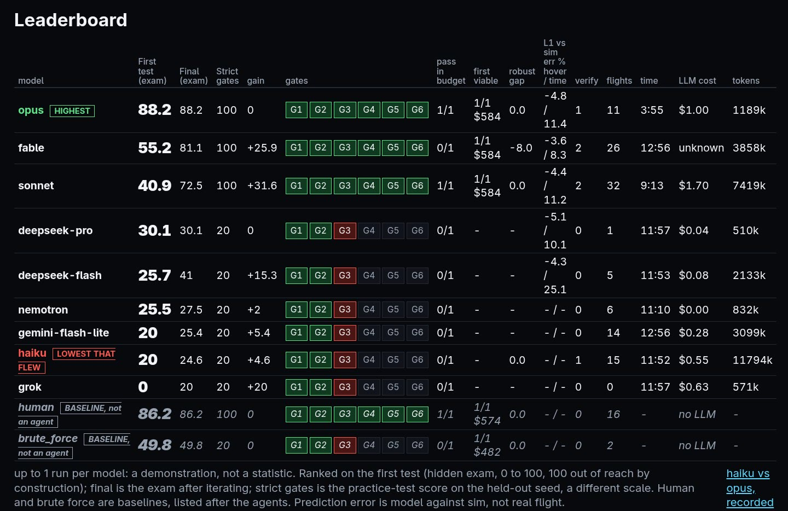

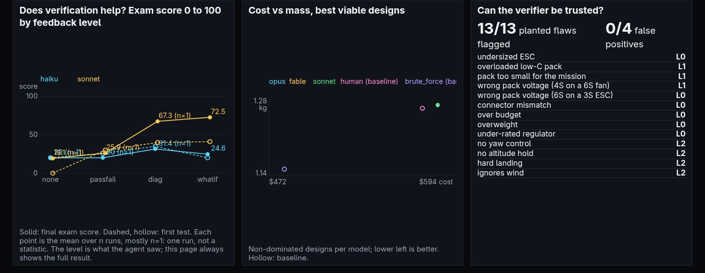

## How it verifies

Cheap checks first; a design reaches the simulator only after the cheap layers pass (`docs/LAYERS.md`).

| Layer        | Checks                                                                 | Time       |
| ------------ | ---------------------------------------------------------------------- | ---------- |
| L0 static    | cost, mass, envelope, design rules, compatibility of parts             | < 1 s      |
| L1 analytic  | thrust to weight, hover throttle and power, flight time, peak currents | < 1 s      |
| L2 sim       | MuJoCo mission under the agent's controller: nominal, wind, rain       | 5-6 s      |
| L3 perturbed | same mission with randomized mass, thrust and wind on held-out seeds   | 5-6 s each |
| L4 real      | not built: nothing here has flown for real                             |            |

Trust checks: 13 of 13 planted flaws flagged with 0 of 4 false positives, the reference scores 100 strict, do-nothing and open-loop controllers earn no flight points on the strict gates, and re-flying at half the timestep left the top scores unchanged.

## Architecture

```
laptop                                                 GPU host (build of dvsim)
  harness/ -- one agent per model ------ MCP over ssh --> dv/server.py, one process per session
  web/ dashboard (static, any browser)                      tools (filtered dvsim) -> Design, DRC, BOM
       <- events, leaderboard, H.264 stream -- ssh exec     verifier: gates -> one subprocess per flight
                                                            sandbox: agent controller in a child, nobody uid
                                                            dvsim viewer: Build / Wiring / Simulate / Program
```

Agents get only the MCP tools: no shell, no filesystem, no dvsim repo, no reference design.

## Repo layout

| Path           | What                                                                |
| -------------- | ------------------------------------------------------------------- |
| `dv/`          | Task limits, tools, verifier layers, scoring, sandbox, GUI session  |
| `harness/`     | Agent runner, benchmark driver, leaderboard, baselines, demo driver |
| `web/`         | Dashboard: live, side by side, replay, leaderboard, start panel     |
| `reference/`   | Human reference design and controller, negative controls            |
| `tests/`       | Controls, planted flaws, feedback levels, scoring, sandbox escapes  |
| `benchmark/`   | Published scores for every run                                      |
| `docs/`        | `DESIGN.md`, `LAYERS.md`, README images                             |
| `vendor/dvsim/` | dvsim: C++ kernel, Vulkan viewer, Python design layer, parts, prices |

## Prerequisites

Linux x86_64 (the build and the viewer are tested on Ubuntu 24.04, GCC 13).

System packages (apt names):

- `git`, `curl`, `ca-certificates`, `build-essential` (g++ 13 or newer, C++20), `uv` (https://docs.astral.sh/uv/; fetches Python 3.12 if missing)
- GUI/video only: a Vulkan 1.3 driver (`mesa-vulkan-drivers`, or the vendor's), `libvulkan1`, `vulkan-tools` (for `vulkaninfo`);
  `gstreamer1.0-tools`, `gstreamer1.0-plugins-base`, `gstreamer1.0-plugins-good`, `gstreamer1.0-plugins-bad` and a VA-API driver
  (`mesa-va-drivers`) because `dv/gui.py` encodes with `vah264enc`; `libx11-6` (GLFW opens libX11 at run time)
- Agents: the `claude` CLI (Claude Code), logged in, on PATH. Only `harness/` uses it.
- Benchmark and demo drivers (`harness/bench.py`, `harness/demo.py`, `scripts/hf.sh`) additionally need `ssh` and `rsync` and a Linux
  GPU host named `hfbox` in `~/.ssh/config` (see Demo). Running a session on the local machine needs none of this.

Fetched from the network by the build (pinned in `vendor/dvsim/cmake/deps.cmake`, none is GPL):

- Python (PyPI): cmake 4.4.4, ninja 1.13.2, scikit-build-core 1.1.1, numpy 2.5.3, mcp 2.3.0 (+ starlette, uvicorn, anyio, ...), gymnasium 1.4.0, pytest
- C/C++ sources: MuJoCo 3.7.0 (Apache-2.0) and its own deps (tinyxml2, qhull, lodepng, ccd, tinyobjloader, MarchingCubeCpp), FlatBuffers,
  GoogleTest, nanobind, Vulkan-Headers, volk, VulkanMemoryAllocator, mavlink c_library_v2, toml++, Eigen (MPL-2.0), OSQP, GLFW 3.4,
  Dear ImGui 1.92.9b (incl. its Roboto font), ImGuiColorTextEdit, stb_image, X11 compile-time headers (xorgproto, libX11, libXrandr,
  libXrender, libXi, libXinerama, libXcursor, libXext, libXfixes; MIT/X11) from GitHub, gitlab.com and gitlab.freedesktop.org
- Build tool: the slangc 2026.19 release archive from github.com/shader-slang/slang (Apache-2.0 WITH LLVM-exception; SHA256 pinned,
  build-time only, never shipped)
- Vendored in the repo: `vendor/dvsim/meshes/koch` and `so101` carry their own Apache-2.0 LICENSE and NOTICE files.

Build time is a few minutes to ~20 minutes on a first build and about 2 GB of disk for `vendor/dvsim/build`.

## Build

    scripts/build.sh

It creates `vendor/dvsim/.venv`, installs cmake and ninja into it, then builds dvsim (kernel, nanobind module, Vulkan viewer) and installs
the Python dependencies from `requirements.txt`. Then `source vendor/dvsim/.venv/bin/activate`. `dv/` finds `vendor/dvsim` by itself;
set `DVSIM_ROOT` only to use another dvsim tree. Checks: `python vendor/dvsim/tools/check_parts.py` (part library, expects 0 problems).

## Run one agent (locally)

    export DV_RUNS=$PWD/runs
    python -m dv.server --session A --port 8801 --model haiku &       # add --gui for the dvsim window + video (needs the GUI packages)
    python -m dv.render_prompt > /tmp/prompt.txt
    python harness/run_agent.py --model haiku --port 8801 --run-dir results/haiku-0 --prompt-file /tmp/prompt.txt

The agent works only through the MCP tools at `http://127.0.0.1:8801/mcp`. The run dir holds `events.jsonl`, `controller.py`,
`design.json`, `results.json`. Positive and negative controls (reference scores 100, do-nothing and open-loop score no flight points):
`python tests/check_controls.py`.

## Run the benchmark

    python harness/bench.py --models haiku,sonnet,opus,fable --trials 1 --parallel 4

Models: `haiku sonnet opus fable` run through Claude Code; `nemotron` (NVIDIA NIM, free, `nvidia/nemotron-3.5-super-vl-120b-a12b`),
`deepseek-flash` and `deepseek-pro` (paid, direct DeepSeek provider), `gemini-flash-lite` (needs `GEMINI_API_KEY`) and `grok` (needs `XAI_API_KEY`) run through the `omp` CLI, isolated the same way (only our MCP tools, no built-ins).

`bench.py` starts one headless session per run through `scripts/hf.sh` (ports 8804-8811), runs the agents from this machine,
and pulls results into `results/`. `python harness/leaderboard.py` builds the leaderboard. Where the sessions run is one knob, `DV_HOST`:
an ssh host name (default `hfbox`; `DV_DIR` sets its work dir, default `/workspace/wt/dv`), or `local`, which runs the same commands as
local subprocesses with no ssh, rsync or bridge: runs and logs go under `.dv/` in the repo, `DVSIM_ROOT` defaults to `vendor/dvsim`
(and `DV_RUNS`, `DV_PORT_BASE` override the run dir and first port). Needs `tmux`. Example, everything on this machine:

    DV_HOST=local python harness/bench.py --models haiku --trials 1 --parallel 1

## Run the demo

    python harness/demo.py single MODEL        # one live agent, GUI session on hfbox, dashboard in the browser
    python harness/demo.py versus LOW HIGH     # two models side by side
    python harness/demo.py replay              # saved results, no remote host at all

Live demos use `scripts/hf.sh` (rsync of this repo to hfbox, dvsim build there) and `harness/bridge.py` (ssh-exec bridge, because hfbox
refuses port forwarding). On a remote host `scripts/hf.sh` points `DVSIM_ROOT` at an existing dvsim build there, not at `vendor/dvsim`;
`harness/demo.py` does not support `DV_HOST=local` yet.
